# Keel app user manual

This manual shows how to use the Keel app and how one purchase order moves through it, from the importer's proposal to the balance paid to the exporter. It is written for someone who has the app in hand, whether a teammate, a judge or a pilot user.

* [What you need](#what-you-need)
* [About the screenshots](#about-the-screenshots)
* [1. Sign up and connect](#1-sign-up-and-connect)
* [2. Find your way around](#2-find-your-way-around)
* [3. One order, step by step](#3-one-order-step-by-step)
* [4. If something goes wrong](#4-if-something-goes-wrong)
* [5. The agent and supplier tabs](#5-the-agent-and-supplier-tabs)
* [6. Troubleshooting](#6-troubleshooting)
* [Running from source](#running-from-source)

The flow behind every screen is in [flujo/flujo-clave.md](../flujo/flujo-clave.md). The evidence of the live run, with every transaction hash, is in [evidence/demo-video/execution-evidence.md](../../evidence/demo-video/execution-evidence.md).

# What you need

Keel Trade is deployed on **Base Sepolia**, a public test network, with test USDC. The backend (API, document reading, the agent that sends the transactions) runs on **AWS**. Nobody uses real money.

| You need | Details |
| --- | --- |
| The Android app (APK) | Download `keel.apk` from https://github.com/FinLinkChile/Keel/releases/latest : the latest release of the Keel repository, under **Assets**. Install it on an Android phone, and if Android asks, allow the installation of apps from that source. It is the Keel test build. It already points to the Keel API on AWS and to the contracts on Base Sepolia, so there is nothing to configure. Two phones let you play both companies, or use one phone and play them one after the other |
| The two test keys | One for the importer and one for the exporter, imported in the app (see below) |
| One document kit | Three PDF files (proforma, bill of lading, commercial invoice) for one order of USD 1.00. See [The documents of the test order](#the-documents-of-the-test-order) |
| Nothing else on your side | The two companies are already registered in the backend and the agent already runs on AWS. The carrier is not an app user: in this deployment AWS signs its attestation automatically (step 6) |

Two phones, or one phone and the web version, are enough to play both companies: the importer and the exporter. The web version is at [keel-app-finlink.vercel.app](https://keel-app-finlink.vercel.app). The order is always between those two.

## The test wallets of the live flow

To run the real flow on the deployment, the importer phone must sign with a key that is an owner of the importer's Safe, and the exporter phone with the key of the registered supplier. Those keys are **not printed in this manual or stored in the repository**: the team gives them to you separately, and they only control test funds on Base Sepolia. The public addresses they correspond to are:

| What it is | Address | Where you see it |
| --- | --- | --- |
| **Importer wallet**, the key you import. It is an owner of the importer's Safe and signs for it | `0xDAAb8A39035c26bff57B35827E91145BbB4Be52B` | **Connected wallet** in **Wallet check** |
| Importer **Safe**: the company account that holds the funds. It is not a key, so you never import it | `0x366E72921895dBFD7688822418BE43E02551Ee82` | The balance on the importer's **Home** |
| **Exporter wallet**, the key you import. It is also the payout account of Lingnan | `0xC419891eE6bdEfa7aE285961C743047E34E1320d` | **Connected wallet** in **Wallet check**, and **Paid only to this account** on the order |
| Carrier, Harbor Line (demo key). AWS signs with it in this deployment | `0xB4B5591aFF224D76dE4D59F9fD832f5aC26B7708` | The transaction on the block explorer |
| `TradeEscrow`: the contract that holds each order | `0x8346c6F1AfbaFF8140D35116fAF5ec07e4232970` | The block explorer |

The importer has two addresses on purpose: the **wallet** is the person who signs, and the **Safe** is the company account that moves the money. The importer's phone shows the Safe's balance but signs with the wallet.

How to load a key into the app is explained in section 1, [Load your test key](#load-your-test-key-before-anything-else). Do it before anything else: without the right key the app cannot sign for the importer or the exporter.

# About the screenshots

The images come from two sources, and each one says which:

* **Live run.** Screen recordings of the app made while it ran against the real AWS API and Base Sepolia, with order PO-0002 of one test dollar. Every step of the flow is shown with them, and each image says *Live run*.
* **Test build.** The few screens that exist only in a test build, **Connect** with its **Wallet check** link and the **Wallet check** screens, come from a local build of the same app. The key in those images is a random one that controls nothing.

# 1. Sign up and connect

The first time, the app asks who your company is, as a Chilean bank would. The form comes filled with the demo company, Pacífico Foods SpA, and every field can be changed. The identity check with TOC is **simulated** in this version: nothing is captured or sent, you only tick the box. Your details stay on the phone.

| | |
| --- | --- |
| 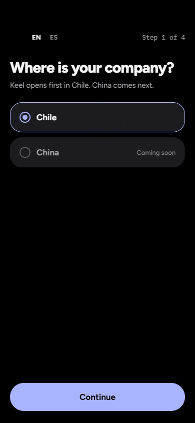 | 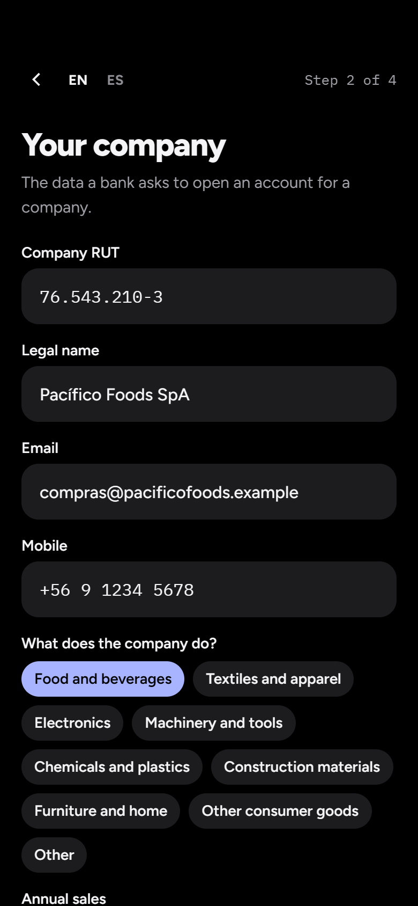 |
| *Live run.* **Step 1 of 4**: the country. Chile is open, China comes next. | **Step 2 of 4**: the company, with its RUT, legal name, sector and sales. The form comes filled with the demo company. |
| 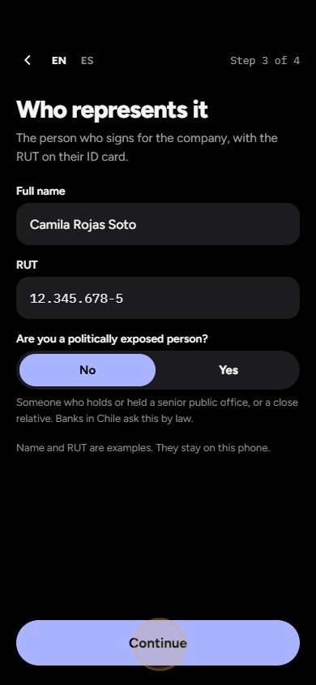 | 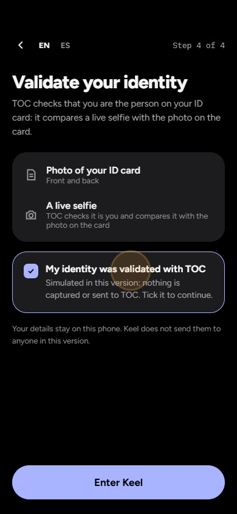 |
| *Live run.* **Step 3 of 4**: the person who signs for the company, with the RUT of the ID card. | *Live run.* **Step 4 of 4**: validate the identity (simulated), then **Enter Keel**. |

The labels **EN** and **ES** at the top switch the language at any time.

Then comes **Connect**:

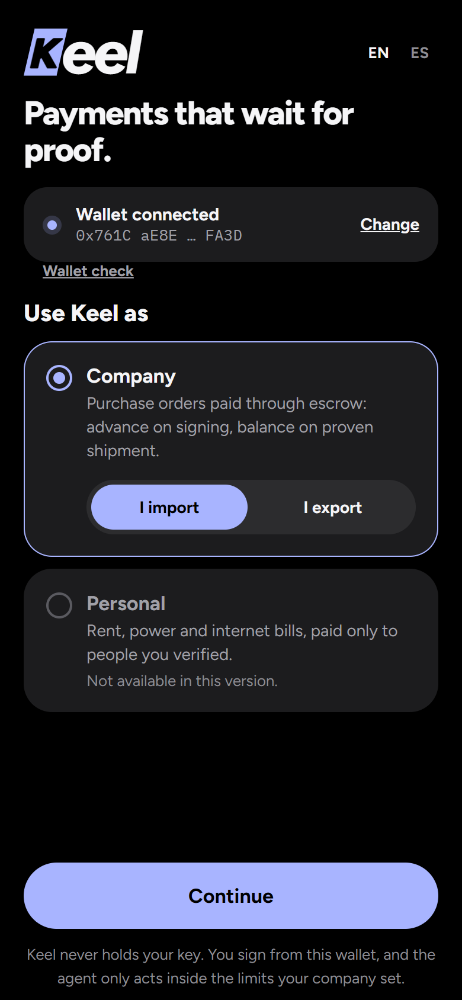

*Test build.* The **Wallet check** link under the wallet card appears only in test builds, like the APK of this manual.

1. Tap **Set up test wallet** the first time. The app makes a key on the phone and keeps it there. Keel never holds it, and the agent only acts inside the limits the company set. This first key is only a placeholder: to use the live deployment you replace it with the test key you were given, in the next subsection.
2. Under **Use Keel as**, choose **Company** and then **I import** or **I export**, according to the company this phone plays. **Choose it now**: the key you load next goes into the role that is selected. **Personal** (rent, power and internet bills) is not available in this version.
3. Do not tap **Continue** yet. First load your test key.

## Load your test key (before anything else)

The test keys are in Annex A of the PDF version of this manual. There is one key for the importer and one for the exporter, and each one only works for its own company. The app signs every order, upload and approval with the key of the role you are in, so without the right key the app signs with the placeholder wallet, which the deployment does not know.

1. On **Connect**, with the role already selected, tap **Wallet check**, the small underlined link under the wallet card. It appears only in test builds.
2. On **Wallet check**, find **Import test key, importer** (or **exporter**). The label shows which role the key will go to. If it names the wrong role, go back and change it on **Connect**.
3. Paste the private key (`0x` followed by 64 characters) into the field. Pasting is easier than typing, and the field hides what you enter, so you will see dots.
4. Tap **Import test key**. The screen says **Loaded as the importer wallet** (or the exporter one).
5. Check the address. **Connected wallet** at the top now shows the address of the key you loaded. It must match the address given next to that key (importer or exporter). If it does not, you loaded the wrong key: import the right one over it.
6. Tap the back arrow at the top left (or the back button of your phone) to return to **Connect**, and tap **Continue**. Going back does not lose the key you imported.

| | | |
| --- | --- | --- |
| 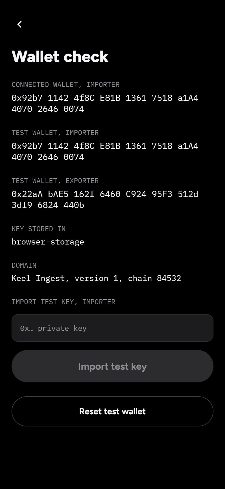 | 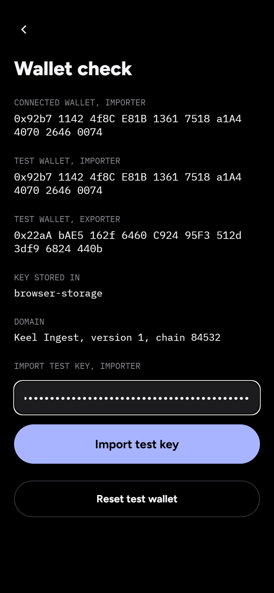 | 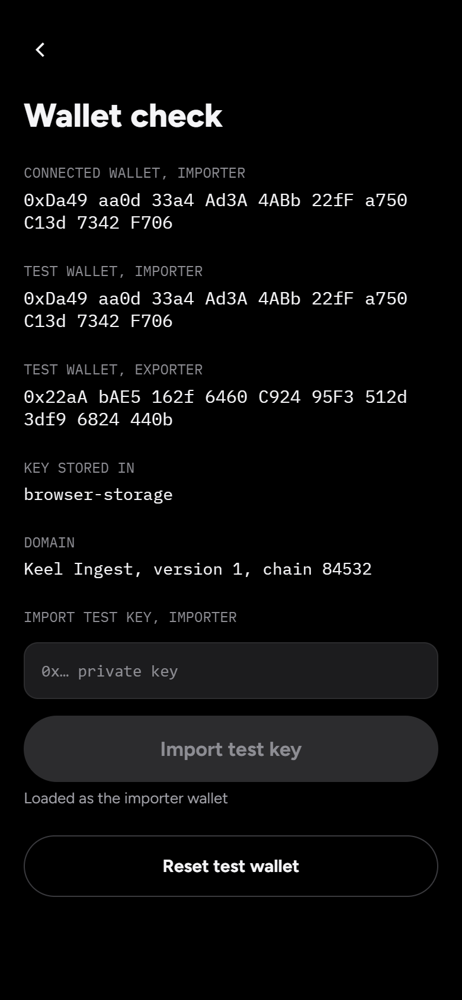 |
| **Wallet check** before the import. **Connected wallet** is still the placeholder, and the field says **Import test key, importer**. | The key pasted. The field shows dots, not the key. | After **Import test key**: the confirmation appears and **Connected wallet** is the address of the key you loaded. |

The images use a random example key that controls nothing, so the address in them is not one of yours. Keep two things in mind:

* **Do not tap Reset test wallet** on this screen: it deletes the keys of both roles from the phone, the importer's and the exporter's, and you would have to import them again. Nothing is deleted on the server.
* **There is no Sign a test upload button in the live build.** That check only exists with the example orders of a development build, and the APK of this manual does not show it. If you see it in another build, ignore it: it only signs a sample message and sends nothing.
* **Treat the keys as secrets**, even though they only control test funds. Do not paste them into chats or repositories. The team can rotate them after the evaluation.

Each role keeps its own key: **Wallet check** lists the test wallet of the importer and of the exporter. If you loaded a key into the wrong role, choose the right role on **Connect** and import the right key there.

# 2. Find your way around

Four tabs at the bottom, and a **+** button in the middle for a new order (importers only).

| Tab | What it is for |
| --- | --- |
| Home | Your balance, what is locked in orders, the agent's limit, and **Needs you**: the things waiting for your signature or your documents |
| Orders | All your orders, **In progress** and **Closed** |
| Agent | The numbers behind your purchases, explained by the analyst (section 5) |
| Suppliers | The companies you can open an order with (importers) |

| | | |
| --- | --- | --- |
| 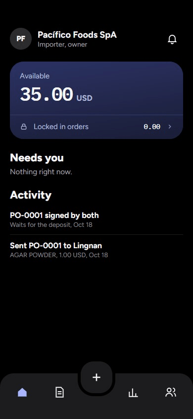 | 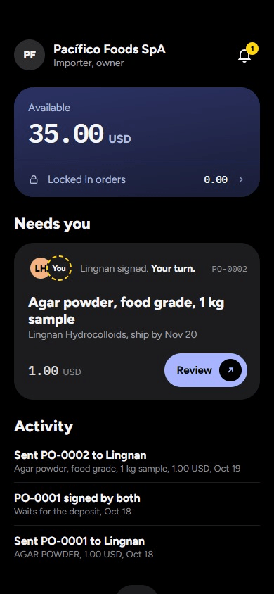 | 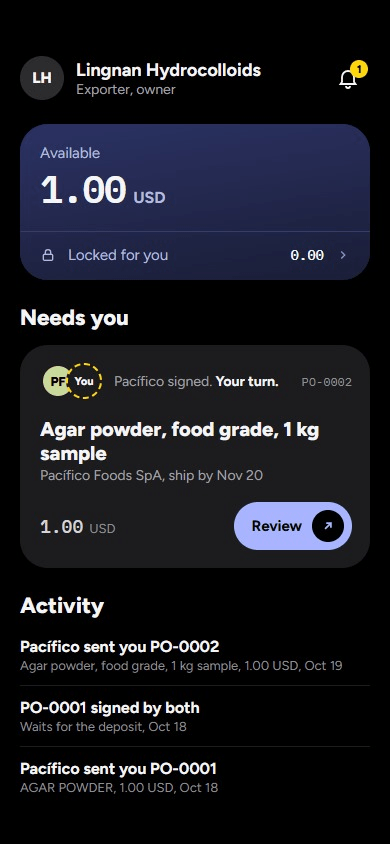 |
| **Home** of the importer. **Available** is the balance of the company's Safe, read from the chain, and **Locked in orders** is what waits in the escrow. *(Live run.)* | **Needs you** on the same screen: here an order that Lingnan already signed and waits for the importer. **Review** opens it. *(Live run.)* | **Home** of the exporter, with an order from Pacífico waiting for it. *(Live run.)* |

| | |
| --- | --- |
| 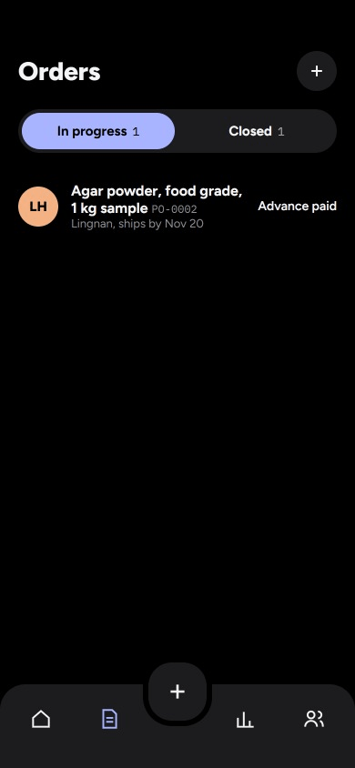 | 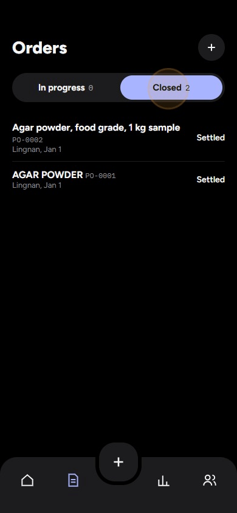 |
| **Orders** of the importer, **In progress**. The word on the right is the state, here **Advance paid**. *(Live run.)* | The **Closed** tab, with the orders already **Settled**. *(Live run.)* |

The exporter sees the same screens with its own view: what it is owed and what is locked for it.

# 3. One order, step by step

Six steps, two companies, one agent. The first two are signatures, the rest happen on their own or with documents. Nobody ever types a payment address: the address comes from the order that **both** companies sign.

```
 1 Importer proposes   2 Exporter signs   3 Importer signs last
          |                    |                    |
          +--------------------+--------------------+
                               |
 4 Agent opens the order, deposits and pays the advance (about 1 minute)
                               |
 5 Exporter ships and uploads the documents
                               |
 6 Carrier attests, importer approves, balance is paid
```

**The app updates itself.** While it is open, every screen reads again every 15 seconds and when you come back to it from another app. A new item in **Needs you**, a document that becomes **Accepted** or the steps of an order change on their own, and you do not need to restart the app. The agent and the engine take a minute or so, so after an action give it a minute before you think something is stuck.

## The documents of the test order

The flow needs three PDF files, and they are not made up on the spot: the engine compares them with the order that both companies signed. They come in ready-made **kits**, in the folder [`docs/entrega/documents/`](documents/) of the repository (and also delivered next to this PDF). Each kit is for one order of **USD 1.00**, one kilo of agar powder from Lingnan to Pacífico, FOB Hong Kong, with Harbor Line as the carrier, and has three files that share the order number:

* `PO-0xxx-1-proforma.pdf`: the importer uploads it when it creates the order.
* `PO-0xxx-2-bill-of-lading.pdf` and `PO-0xxx-3-commercial-invoice.pdf`: the exporter uploads them once the advance is paid.

| Kit | Order number to type in the app | Bill of lading | Folder |
| --- | --- | --- | --- |
| `kit-1` | `PO0401` | `HLIN-2610-0401` | [`documents/kit-1/`](documents/kit-1/) |
| `kit-2` | `PO0402` | `HLIN-2610-0402` | [`documents/kit-2/`](documents/kit-2/) |
| `kit-3` | `PO0403` | `HLIN-2610-0403` | [`documents/kit-3/`](documents/kit-3/) |
| `kit-4` | `PO0404` | `HLIN-2610-0404` | [`documents/kit-4/`](documents/kit-4/) |
| `kit-5` | `PO0405` | `HLIN-2610-0405` | [`documents/kit-5/`](documents/kit-5/) |
| `kit-6` | `PO0406` | `HLIN-2610-0406` | [`documents/kit-6/`](documents/kit-6/) |
| `kit-7` | `PO0407` | `HLIN-2610-0407` | [`documents/kit-7/`](documents/kit-7/) |
| `kit-8` | `PO0408` | `HLIN-2610-0408` | [`documents/kit-8/`](documents/kit-8/) |
| `kit-9` | `PO0409` | `HLIN-2610-0409` | [`documents/kit-9/`](documents/kit-9/) |
| `kit-10` | `PO0410` | `HLIN-2610-0410` | [`documents/kit-10/`](documents/kit-10/) |

Rules that keep the test from failing:

* **Use the three files of the same kit for one order.** The invoice carries the order number, the amount (1.00 USD) and the HS code (1302.31), and the engine checks them against the signed order. The app writes the order number without the hyphen (`PO0401`), and that is fine.
* **Never reuse a kit.** The escrow contract accepts each bill of lading number only once. If a second order uses the same bill of lading, the contract refuses it with `BillOfLadingAlreadyUsed` and the order never reaches the balance. For a new attempt, take the next kit.
* **Set the order number of the kit when you create the order.** The app proposes its own number (the next of the importer's sequence), and the engine compares the invoice with it. In the terms of the new order, tap **Correct a term** and type the number of the kit without the hyphen (`PO0401`). After reading the proforma the terms should also show a total of 1.00, FOB, HS code 130231 and ship by 20 Nov 2026.
* **Do it before 20 Nov 2026.** That is the shipment deadline printed on the proformas. After it the order can no longer be shipped.
* **The date of the bill of lading is 19 Nov 2026, on purpose.** The shortcut of step 6 signs the carrier's attestation with the time of the signature when the printed date is in the future, and the escrow does not accept an on-board date earlier than the deposit. As a result the engine may report a difference in the on-board date. This does not stop the importer from approving the balance.

To play the exporter's uploads and the importer's proforma you need these files on the phone: send them to it by mail, Drive or messaging, and pick them with **Choose file**.

## Step 1. The importer proposes the order

1. Tap **+**, in the middle of the bottom bar, to start a new order.
2. Tap **Choose a supplier** and pick **Lingnan Hydrocolloids**.
3. Upload the supplier's proforma with **Choose file** (or **Scan**): the first file of your kit. The file appears with the number of terms the agent read from it. If you have no proforma, **Fill in by hand** lets you type the terms, but the order cannot be sent without a proforma attached.
4. **Add the title of the order.** The agent does not fill it in: type what is being bought in the field **What is being bought**, for example `Agar powder, food grade, 1 kg sample`. It is the name the order carries on both phones, in lists and on the order screen.
5. Check the total (1.00 for these kits) and the **Advance when both sign**: 30% on signing, 70% when the shipment is proven.
6. Check the terms, set the order number as explained below, and tap **Send to Lingnan**.

On AWS, the quarantined AI reads the proforma and returns typed fields only: amount, deadline, incoterm and HS code. It never returns the payee account. **You check what it read before anyone signs**, and you can correct any term.

| | | |
| --- | --- | --- |
| 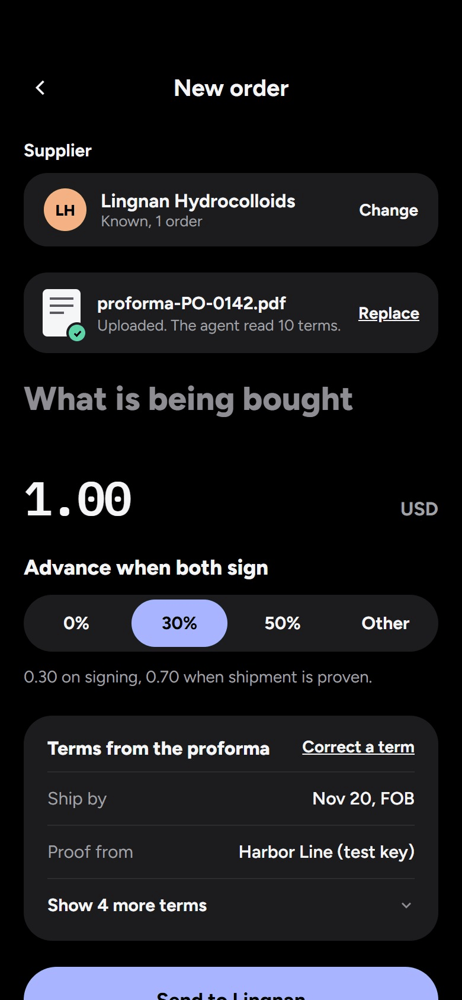 | 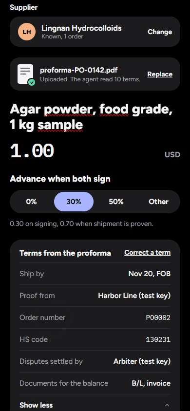 | 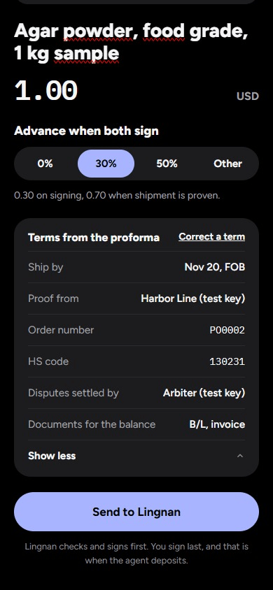 |
| *Live run.* The proforma is uploaded and the agent reads 10 terms. The title field, **What is being bought**, is still empty. | The title typed, the total of 1.00 and the **Advance when both sign**. | All the terms it read, expanded: **Proof from** (the carrier), **Order number**, **HS code** and **Disputes settled by** (the arbiter). **Send to Lingnan** sends the order. |

| | |
| --- | --- |
| 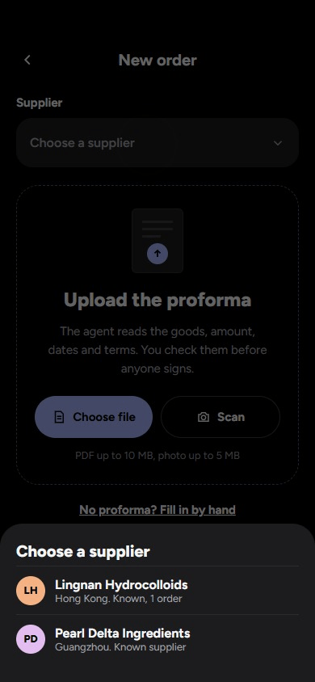 | 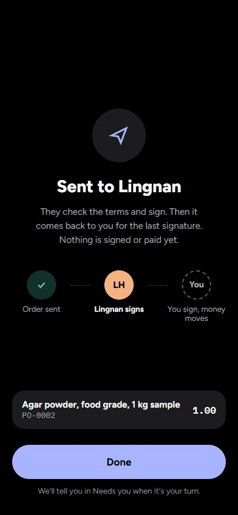 |
| *Live run.* **Choose a supplier**: only registered suppliers appear. | *Live run.* The order is sent, and the screen says what comes next: the supplier signs, then you sign, and the money moves only after both signatures. |

If a term is missing or wrong, the fields are marked in red with what to fix, and **Send to Lingnan** does nothing until they are right.

**Check the order number before you send.** The app does not read it from the proforma: it proposes the next number of the importer's sequence (**PO0002** in the images). The engine compares the invoice with it later, so change it to the number of your kit (for example `PO0401`, letters and digits, no hyphen): tap **Correct a term**, edit **Order number**, and tap **Done**. You can also change the **Advance when both sign** (0%, 30%, 50% or other).

## Step 2. The exporter reviews and signs

The order arrives at the exporter's **Needs you**. It opens the order with **Review**.

| | | |
| --- | --- | --- |
| 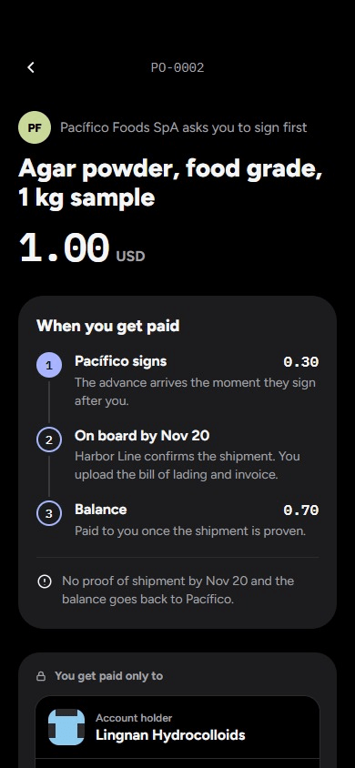 | 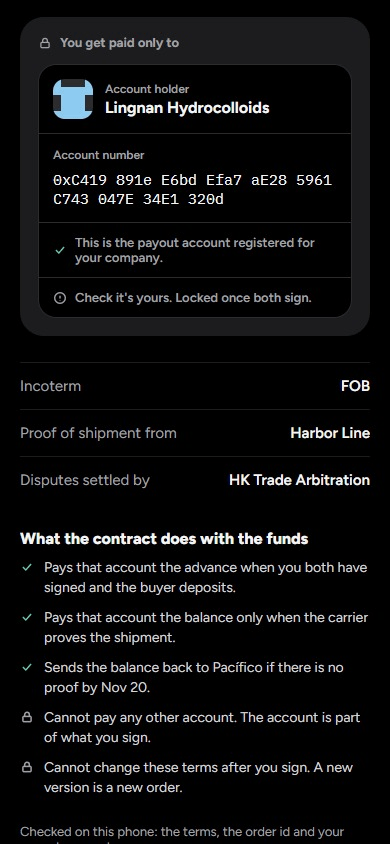 | 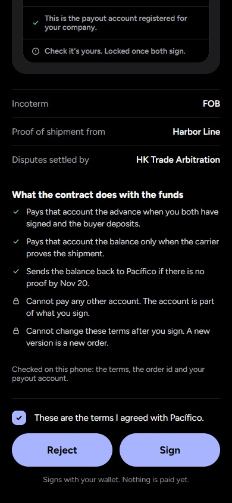 |
| *Live run.* The exporter's review: who asks it to sign first and **When you get paid**. | The payout account, which is part of what both sign. | The contract's rules, then **These are the terms I agreed with…** ticked and **Sign**. |

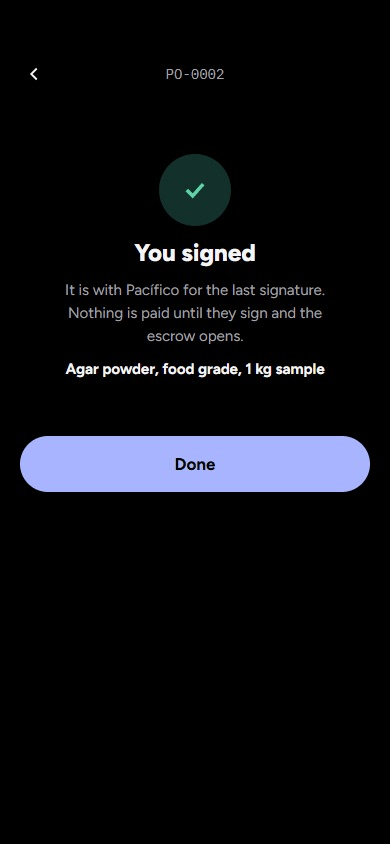

*Live run.* **You signed.** Nothing is paid until the importer signs too.

The review screen shows where the exporter will be paid, and that account is part of what both sign. It also explains **what the contract does with the funds**: it pays the advance when both have signed and the buyer deposits, it pays the balance only when the carrier proves the shipment, and it sends the balance back to the buyer if there is no proof by the deadline. The exporter ticks **These are the terms I agreed with…** and taps **Sign**. It signs structured data with its own wallet, not a PDF. **Reject** declines the order.

After signing, nothing is paid yet: the order waits for the importer's signature.

## Step 3. The importer signs last

The importer opens the order from **Needs you**. It reads the same terms, and the account where the exporter will be paid, which is locked once both sign.

| | | |
| --- | --- | --- |
| 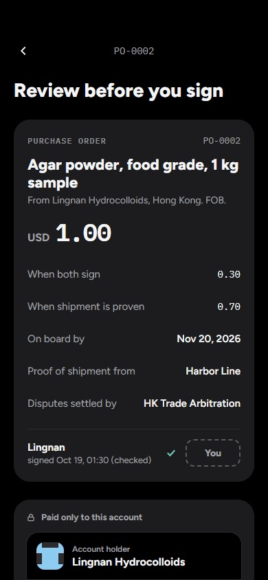 | 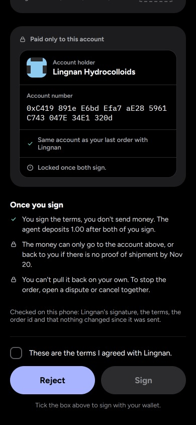 | 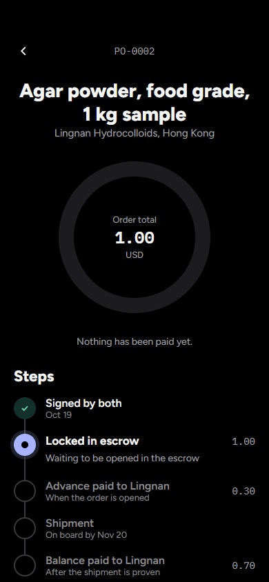 |
| *Live run.* **Review before you sign**: the purchase order, with the exporter's signature already on it. | The account where Lingnan will be paid, locked once both sign, and **Once you sign**, with the tick and **Sign** at the bottom. | After signing: **Nothing has been paid yet**, and **Locked in escrow** waits to be opened by the agent. |

> **Wait about 1 minute.** After the importer signs, the agent on AWS opens the order in the escrow on its next pass, and that takes about a minute. Until then the order says **Locked in escrow** with **Waiting to be opened**.

**Once you sign**: you sign the terms, you do not send money. The agent deposits the full amount after both signatures. The money can only go to the account shown, or back to you if there is no proof of shipment by the deadline. You cannot pull it back on your own: to stop it, open a dispute or cancel together.

## Step 4. The agent deposits and pays the advance

**The agent takes about 1 minute to open the order.** You do nothing. The agent on AWS checks the company's policy and, on its next pass (every minute), opens the order in the escrow and deposits the full amount from the importer's Safe. In the same transaction, the contract pays the advance to the exporter. Each step leaves a transaction hash on Base Sepolia.

| | |
| --- | --- |
| 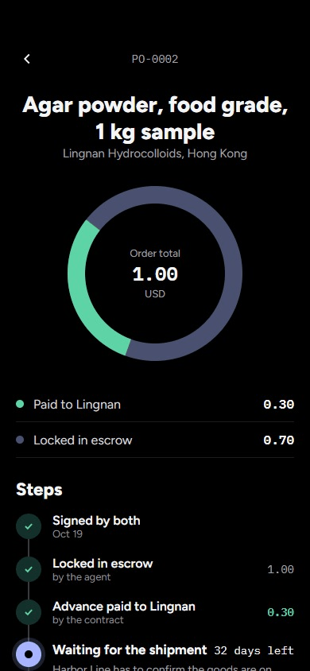 | 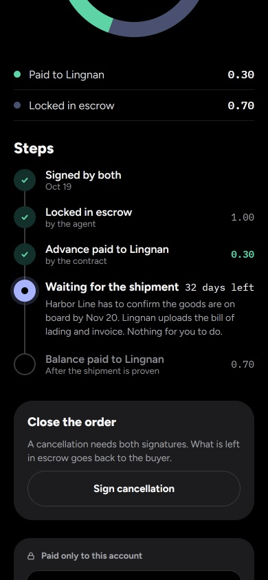 |
| *Live run.* The importer's order after the agent acted: **Paid to Lingnan 0.30**, **Locked in escrow 0.70**. | **Steps** with the actor of each one (the agent, the contract), and the days left for the shipment. |

On the order screen, read from the top:

* The **ring** and the two lines under it: what has been paid and what is still locked.
* **Steps**: signed by both, locked in escrow, advance paid, shipment, balance. The current step shows how many days are left.
* **Paid only to this account**: the account that both signed. A new bank account that appears in a document is ignored.

## Step 5. The exporter ships and uploads the documents

When the exporter has shipped, its order shows **Ship by … and send the documents**, with an **Upload** button for the **Bill of lading** and the **Commercial invoice**.

| | | |
| --- | --- | --- |
| 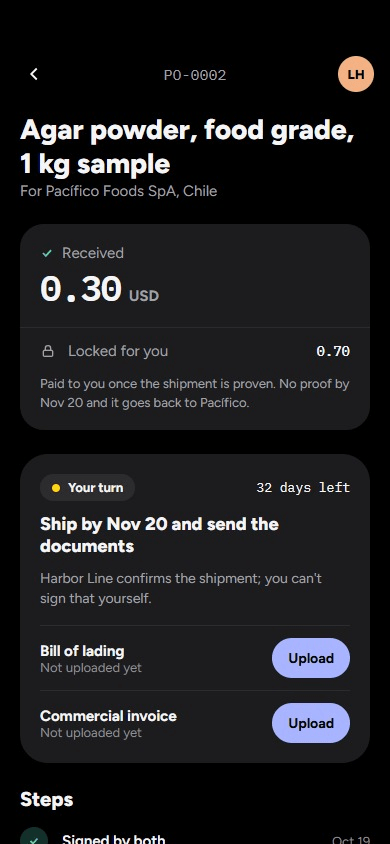 | 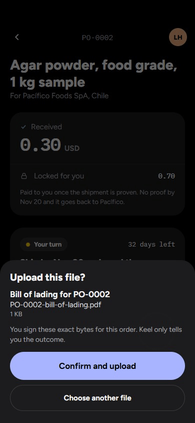 | 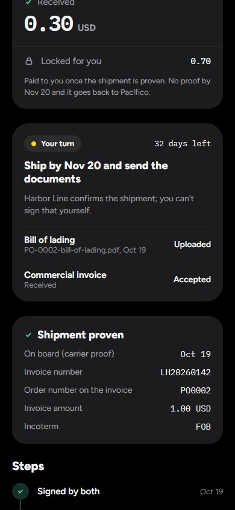 |
| *Live run.* The exporter's order: **Ship by … and send the documents**, with an **Upload** button for each one. | **Upload this file?** The wallet signs these exact bytes, and **Confirm and upload** sends them. | Both uploaded. The engine checks each one against the order and marks it **Accepted**, and the order shows **Shipment proven**. |

1. Tap **Upload**, choose the bill of lading or the invoice of the same kit (a PDF up to 10 MB or a photo up to 5 MB) and confirm with **Confirm and upload**.
2. Each upload is signed by the exporter's wallet: *you sign these exact bytes for this order*. Keel only tells you the outcome.
3. The row says **Uploaded** as soon as the file has left the phone. The AI then reads the document and the rules engine compares it with the signed order: the order number, the amount and the HS code. Within a minute or so the row changes by itself to **Accepted**, or to **Under review** if something does not match.

## Step 6. The carrier attests and the balance is paid

The carrier signs that the cargo is on board, and the contract needs that second signature before it pays the balance. Harbor Line is not an app user, and **in this deployment you do not have to do anything**: once the order is funded and the exporter has uploaded the bill of lading and the invoice, AWS signs the carrier's attestation itself with the test key of Harbor Line. The order becomes **Shipped** on its own within a minute or two.

This is a **demo shortcut** (`demo_auto_attest`), switched on in this test deployment so the demo runs without someone playing the carrier. It has a cost that should be said plainly: here the server signs for the carrier, so a fabricated bill of lading would prove a shipment. In a real deployment the carrier signs independently (see the security notes of the README and [flujo/amenazas.md](../flujo/amenazas.md)). In the recorded run of 19 Oct 2026 the team sent the attestation by hand with `aws/scripts/carrier-attest.ts`.

The shortcut does nothing when the order names a carrier other than Harbor Line, when the order is not funded yet, or while the documents are not read. If the order stays at **Shipment and documents** after both uploads, wait a minute and check that both documents show **Accepted**; the screen updates by itself.

Then the importer closes the order:

| | | |
| --- | --- | --- |
| 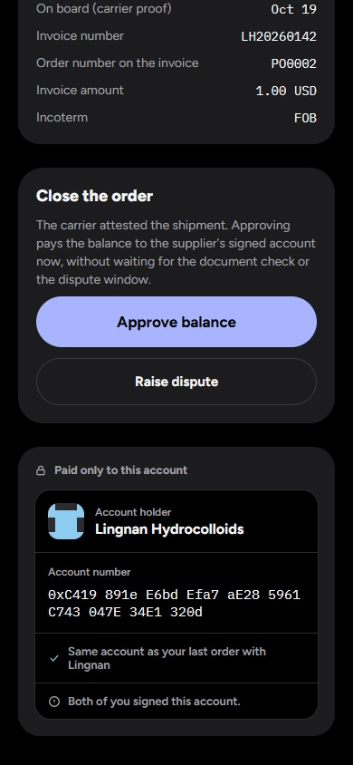 | 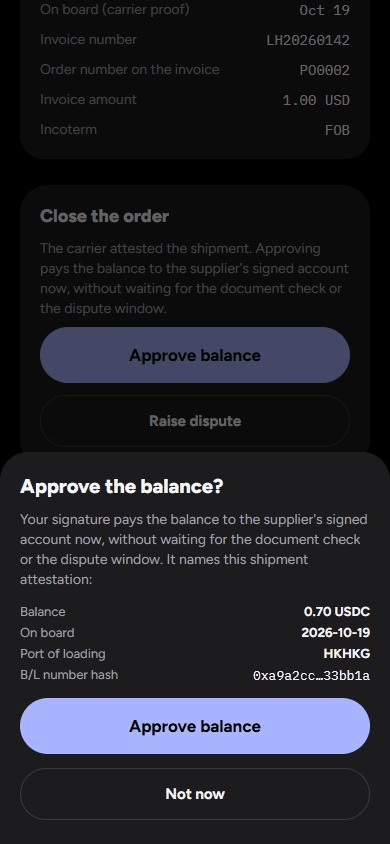 | 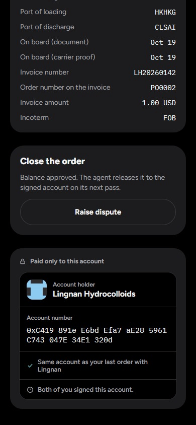 |
| *Live run.* The importer's order: **Close the order**, with **Approve balance** and **Raise dispute**. | **Approve the balance?** shows the amount and the carrier's attestation it names: the on-board date, the port and the B/L number hash. | **Balance approved.** The agent releases it on its next pass. |

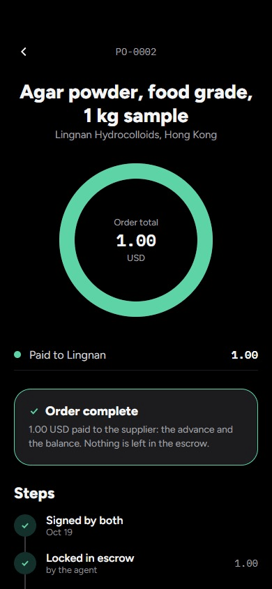

*Live run.* **Order complete**: the advance and the balance were paid and nothing is left in the escrow.

The importer sees **Shipment proven**, with the bill of lading and invoice data, and **Close the order**. **Approve balance** opens the confirmation, and approving pays the balance to the exporter's signed account.

If the importer does not approve, the verifier releases the balance after the dispute window, as long as the documents match the order. **Raise dispute** stops it instead (see section 4).

In **Orders**, an order goes through these states: **Review** (waiting for a signature), **Signed**, **Advance paid**, **Shipped**, and **Settled** when everything was paid. When something goes wrong it ends as **Refunded** (no proof of shipment in time, and the balance went back to the importer) or **Cancelled** (both agreed to stop).

# 4. If something goes wrong

| Situation | What happens | What you do |
| --- | --- | --- |
| The exporter never ships | After the deadline with no valid proof, the balance goes back to the importer. Anyone can trigger the refund | Nothing: the order shows **Refunded** and **Back to you** |
| A document stays **Under review** | The rules engine has not accepted it against the signed order | Check the file, upload the right one, or **Raise dispute** |
| One side disagrees | Either party can raise a dispute before the order closes, and the arbiter resolves | **Raise dispute** on the order screen |
| Both agree to stop | The funds not yet released go back to the importer | **Sign cancellation**. It needs both signatures, so the other side sees **Cancel … ?** in **Needs you** |
| An email or a document names a new bank account | Nothing changes: the payout account is the one both signed | Ignore it. A different account requires a new signed order |

The refund, the dispute and the cancellation follow [flujo/disputa-y-cancelacion.md](../flujo/disputa-y-cancelacion.md) and [flujo/paso-6-reembolso.md](../flujo/paso-6-reembolso.md).

# 5. The agent and supplier tabs

**Agent** is the importer's purchasing analyst. It reads numbers computed on the phone, with suppliers as S1 and S2, never documents or names. It cannot sign and it cannot move money. Tap **Analyze my purchases** for its reading. The page shows, for 30 days, 90 days or all:

* **Summary**: how much you bought, the average order, what is locked in escrow and the average advance.
* **Risk**: the advance paid before shipment, shipped on time, refunds and documents accepted.
* **By supplier** and **By product**, and **Next 14 days** with the ship-by dates coming up.

The exporter sees the same tab from its side: what it sold, what it was paid and how it delivered.

*These tabs were not part of the recorded run, so there are no screenshots of them here.*

Adding a supplier and the test transfer that verifies it are not available in this version: a team member registers suppliers in the backend. The exporter sees **Suppliers are managed by the importer**.

# 6. Troubleshooting

| What you see | Why | What to do |
| --- | --- | --- |
| **The agent could not read this file** | The proforma is not readable | Fill in the terms by hand and keep the file attached |
| The importer cannot sign | The key you imported is not an owner of the importer's Safe, or the app is on the exporter role | Check the address in **Wallet check** against the importer address in the table at the start, and select **I import** |
| The exporter cannot sign or be paid | The key you imported is not the registered supplier, or the app is on the importer role | Check the address against the exporter address in the table, and select **I export** |
| The advance has not arrived, or **Needs you** shows nothing new | The agent runs once a minute, and the app reads again every 15 seconds | Wait a minute. If nothing changes after two, close the app and open it again. Each payment has a hash on Base Sepolia |

Anything else that fails leaves a message with its reason on the screen, and a refusal from the backend shows as a notice. Signing never waits for the backend.

## Running from source

Only for the team and for anyone who runs the web version or Expo Go. The APK has these values built in. The app reads them from `app/.env` (see [app/.env.example](../../app/.env.example)), and a change needs a restart with `npx expo start -c`.

| What you see | Why | What to do |
| --- | --- | --- |
| Nothing reaches AWS, orders stay on the phone | `EXPO_PUBLIC_API_URL` is empty | Set it to the API address (the `api_endpoint` of the Terraform deployment), without a stage suffix such as `/prod` |
| Every request is rejected as a bad signature | The API address has a stage suffix | Use the bare address: the API uses the `$default` stage |
| Uploads are rejected as **not_a_party** | `EXPO_PUBLIC_CHAIN_ID` does not match the deployment | Use the same chain id (84532 for Base Sepolia) |
| The importer cannot sign | `EXPO_PUBLIC_IMPORTER_SAFE` is not set | Set the importer's Safe address |
| **Wallet check** does not appear | `EXPO_PUBLIC_WALLET_CHECK` is not `1` | Set it to `1` in a test build |
| The app shows example orders | `EXPO_PUBLIC_DEMO_SEED=1` | Leave it empty to start with no data |
| The exporter cannot be paid or the order does not open | The exporter is not registered in the backend | A team member registers it with `POST /suppliers` as in the [deployment steps](../../README.md#deploy-the-backend-on-aws) |

# What this manual does not cover

* **Keel Personal** (bills): the app marks it as not available in this version. It is designed in [personal/keel-personal.md](../personal/keel-personal.md).
* **The Telegram bot**: it only sends template notices and signs nothing, see [bot/README.md](../../bot/README.md).
* **Deploying the backend and the contracts**: see the [README](../../README.md#deploy-the-backend-on-aws).
