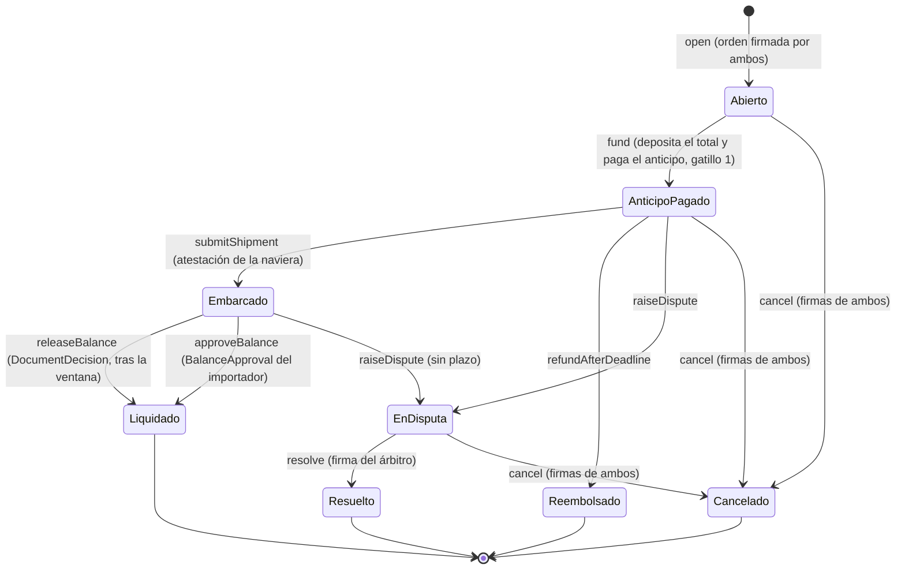

# Estados en el contrato

`uint8` en este orden: `NONE (0), OPEN, ADVANCE_PAID, SHIPPED, SETTLED, REFUNDED, DISPUTED, RESOLVED, CANCELLED` (Abierto, AnticipoPagado, Embarcado, Liquidado, Reembolsado, EnDisputa, Resuelto, Cancelado). La misma lista está en `ESCROW_STATES` de `schemas/src/index.ts`. No existe un estado Depositado: el depósito y el anticipo ocurren en la misma transacción ([decisión 2](../decisiones/abiertas.md), [paso 3](paso-3-anticipo.md)).

# Reglas de la máquina

- Cada función acepta solo los estados de origen del diagrama. Cualquier otra llamada revierte con `InvalidState`.
- Liquidado, Reembolsado, Resuelto y Cancelado son finales: no se vuelve a mover dinero de esa orden.
- Embarcado no tiene salida por vencimiento: con el embarque probado, el saldo sale por el gatillo 2 o por una disputa ([decisión 3](../decisiones/abiertas.md), [paso 5](paso-5-saldo.md)).
- Cada transición incrementa `stateVersion` de la orden. La firma de cancelación queda atada a la versión y al estado (`cancelNonceOf`), así que solo vale en el estado en que se firmó ([disputa y cancelación](disputa-y-cancelacion.md)).

# Invariantes que se prueban con fuzz

1. Lo pagado en total nunca supera lo depositado.
2. Ningún fondo sale hacia una dirección que no sea `importer` o `payoutAddress`.
3. Un estado final nunca vuelve a mover fondos.
4. Un mismo BL (por naviera) nunca liquida dos órdenes.

La primera es la invariante principal. Además, el saldo del token en el escrow es igual a la suma de los saldos de las órdenes depositadas que no están en un estado final. Las funciones que producen cada transición están en [datos firmados e interfaz](datos-firmados-e-interfaz.md).
