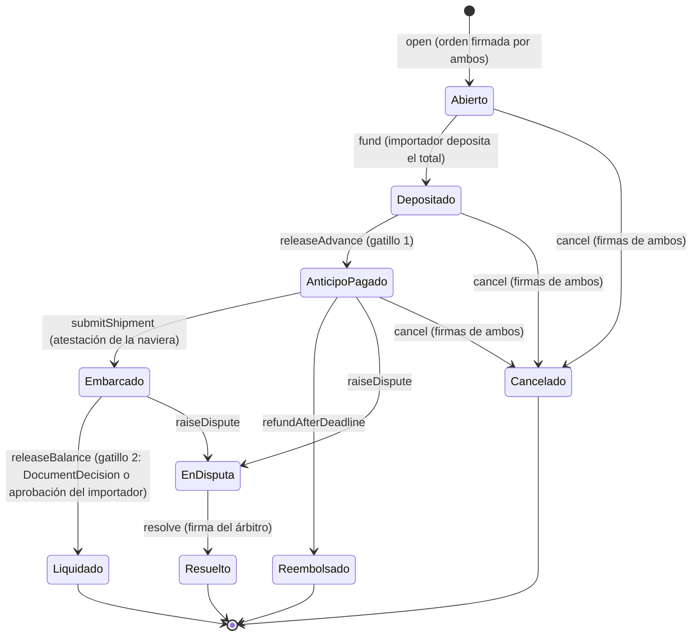

# Reglas de la máquina

- Cada transición tiene un único estado de origen permitido. Cualquier otra llamada revierte con `InvalidState`.
- Liquidado, Reembolsado, Resuelto y Cancelado son finales: no se vuelve a mover dinero de esa orden.
- Embarcado no tiene salida por vencimiento: con el embarque probado, el saldo sale por el gatillo 2 o por una disputa ([decisión 3](../decisiones/abiertas.md)).

# Invariantes que se prueban con fuzz

1. Lo pagado en total nunca supera lo depositado.
2. Ningún fondo sale hacia una dirección que no sea `importer` o `payoutAddress`.
3. Un estado final nunca vuelve a mover fondos.
4. Un mismo BL nunca liquida dos órdenes.

La primera es la invariante principal. Las funciones que producen cada transición están en [datos firmados e interfaz](datos-firmados-e-interfaz.md).
