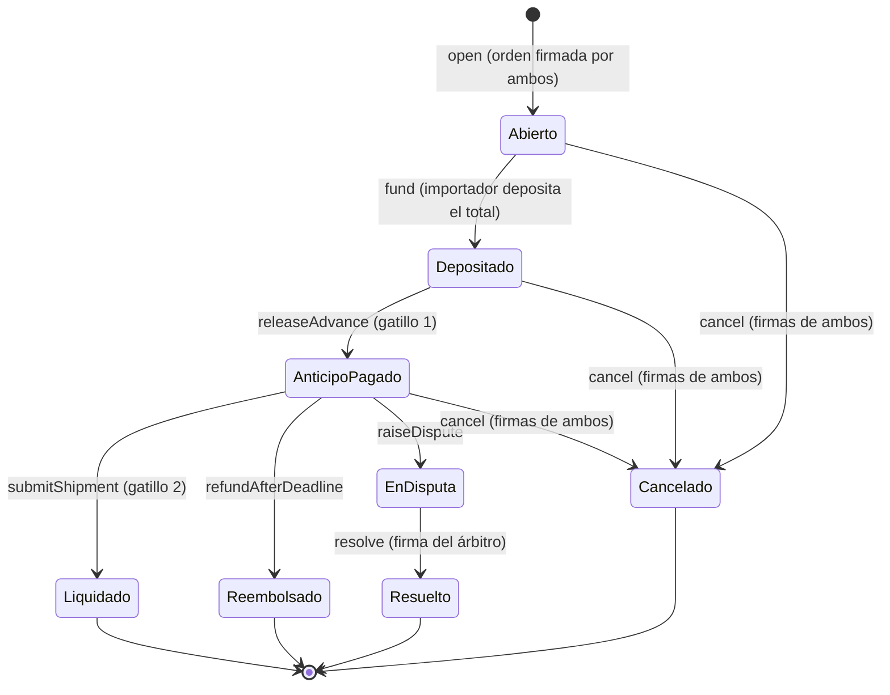

# Keel: objetivo del proyecto y flujo clave

**Para qué sirve este documento:** define el objetivo de Keel y el flujo que el proyecto implementa. Se consulta cada vez que se idea o se crea un componente nuevo, para confirmar que está alineado con el objetivo del equipo. Si un diseño contradice este documento, se cambia el diseño o se discute el cambio con el equipo y se actualiza aquí primero.

**Versión:** 13 de octubre de 2026.

**Fuentes:**

- [KEEL_SOLUCION_ALCANCE.md](KEEL_SOLUCION_ALCANCE.md): solución, alcance y diseño detallado. Su sección 5 (Keel Trade) es el diseño de referencia de este flujo, y sus secciones 3, 6, 7 y 8 aportan principios, sistema de pago, seguridad y regulación.
- [reunion_comercio_exterior.md](reunion_comercio_exterior.md): entrevista con un importador chileno.
- [keel-documento-tecnico.md](keel-documento-tecnico.md): la propuesta anterior (pago de cuentas), de donde viene la base de agent wallet.
- [keel_division_trabajo.md](keel_division_trabajo.md): decisiones transversales D1 a D10 y áreas.

**Cambio de rumbo:** Keel dejó de ser un pagador de cuentas. El proyecto es ahora la aplicación del flujo de escrow a la importación de productos. Donde este documento y los anteriores no coincidan, vale este. En particular, queda sin efecto el reparto de [KEEL_SOLUCION_ALCANCE.md](KEEL_SOLUCION_ALCANCE.md) (secciones 1.3, 2.1 y 4) que dejaba el pago de cuentas como lo que se construye y el comercio exterior como visión.

Lo marcado como **[ABIERTO]** falta decidirlo o verificarlo. Lo marcado como **[PROPUESTA]** es un diseño sugerido que el equipo todavía no confirma.

---

## 1. Objetivo

Keel es un **agent wallet para comercio exterior**: una billetera operada por un agente de IA que paga órdenes de compra internacionales **solo cuando se cumplen condiciones verificables**, usando un contrato de escrow programable en lugar de la custodia bancaria de una carta de crédito.

En una carta de crédito, los bancos guardan la plata y la liberan cuando se cumplen las condiciones. En Keel, un smart contract hace lo mismo:

1. El importador deposita los fondos en el contrato. Quedan bloqueados: el importador ya no puede retirarlos libremente y el exportador todavía no los recibe.
2. El contrato tiene escritas las condiciones de la orden de compra: documentos exigidos, montos y plazos.
3. **Gatillo 1:** orden de compra aceptada por ambos. Se libera el anticipo.
4. **Gatillo 2:** embarque probado, con BL y factura validados. Se libera el saldo.
5. **Vencimiento:** si pasa la fecha de embarque y no llega la prueba, el saldo vuelve al importador.

**Contexto:** la importación de productos desde China por parte de empresas chilenas, que es el caso validado en la entrevista.

**Corredor objetivo:** Chile con Hong Kong, sobre una **red cerrada** (permisionada, con participantes identificados). En China continental el comercio con criptomonedas está prohibido desde 2021, por lo que la liquidación se plantea en Hong Kong.

Lema: **la IA interpreta una vez, el contrato obedece siempre.**

Competencia: 2026 Shenzhen FinTechathon, International Track, Topic F: Agent Wallet.

---

## 2. Qué significa que Keel sea un agent wallet

Keel no es solo un contrato de escrow. Es una billetera en la que un agente hace el trabajo operativo (leer documentos, preparar pagos, vigilar plazos) con permisos acotados, mientras las reglas viven en contratos que ni el agente ni un atacante pueden cambiar.

### 2.1 Las piezas de la billetera

Vienen de la propuesta anterior y se mantienen:

| Pieza | Qué hace |
| --- | --- |
| Safe | La cuenta de la empresa. Los dueños son personas, nunca el agente |
| Zodiac Roles Modifier v2 | Limita al agente: a qué contrato puede llamar, qué función y con qué cupo |
| Zodiac Delay Modifier | Los cambios de configuración esperan N horas, con aviso y ventana de veto |
| PDRGate | Único miembro del rol del agente (D4). Sin un PDR válido no se mueve nada |
| PDR (Registro de Decisión de Política) | Decisión firmada con EIP-712 que ata la intención, la política y el calldata exacto |
| Motor de política | Función determinista, sin LLM ni red. Decide el nivel y firma el PDR |
| Extractor en cuarentena | El único LLM. Lee documentos no confiables y devuelve un esquema sin texto libre (D2, D3) |
| Cosignatario | Persona de confianza. Puede frenar, vetar y pausar. No puede enviar fondos |

### 2.2 Qué es "el agente"

El agente es la cadena completa: extractor en cuarentena, parser determinista, motor de política, PDR y relayer. No existe un LLM operativo que decida pagos (D2).

- **La IA lee.** Extrae datos de proformas, órdenes de compra, BL y facturas.
- **El motor decide.** Compara lo extraído con lo pactado y define el nivel de permiso.
- **Las personas autorizan.** Firman la orden de compra y cofirman lo que supera los límites.
- **El contrato ejecuta.** Custodia los fondos y solo los mueve por las transiciones permitidas.

### 2.3 Niveles de permiso

| Nivel | Nombre | Dónde se hace cumplir |
| --- | --- | --- |
| 0 | Leer | Quien lee no tiene llaves ni permisos |
| 1 | Autónomo | Motor, PDRGate y Roles |
| 2 | Con espera | Delay Modifier: espera y veto |
| 3 | Cofirma | PDRGate exige la firma del cosignatario |
| 4 | Prohibido | El rol del agente no lo permite |

La sección 7 aplica estos niveles a cada acción del flujo de comercio exterior.

---

## 3. Principios que no se rompen

Si un componente nuevo rompe alguno, está mal diseñado.

1. **La dirección de pago nunca sale de un documento.** Sale de la orden de compra firmada por ambas partes. Un correo o un PDF nunca puede cambiar a quién se paga.
2. **Se firman datos, no papeles.** Toda autorización es una firma EIP-712 sobre datos estructurados, atada a una red y a un contrato. Una firma escaneada en un PDF es una imagen y no prueba nada.
3. **Separación de poderes.** La IA lee, el motor decide, las personas autorizan y el contrato ejecuta. Ninguna pieza hace el trabajo de otra.
4. **Defensa en profundidad.** Cada capa asume que la anterior pudo fallar. Si el motor se compromete, el contrato sigue limitando destino y monto.
5. **Quien frena no puede robar.** El cosignatario y el árbitro pueden detener o decidir entre las partes, pero nunca enviarse fondos.
6. **Todo deja evidencia.** Cada pago, bloqueo y revert queda con su hash en la cadena, y cada decisión es reproducible.

Reglas operativas que se mantienen (de la división del trabajo):

- No hay LLM operativo. El único LLM es el extractor en cuarentena, sin herramientas y con esquema sin texto libre.
- Ninguna llave de servidor es dueña ni módulo directo de una Safe. La llave del dueño nunca vive en un servidor.
- Fallar cerrado siempre avisa: motivo, fecha de vencimiento y alternativa manual.
- Sin sobreafirmaciones: cada afirmación de seguridad dice para quién vale, dónde se hace cumplir y qué prueba la demuestra.
- Lo que se entrega al jurado va en inglés.

---

## 4. El problema

Validado en la entrevista con un importador chileno que compra a China y Alemania:

- La lógica de fondo es universal: **garantía de pago contra garantía de envío**. Lo que cambia entre países y productos son los documentos exigidos.
- La carta de crédito da esa garantía, pero es cara y lenta, y con China casi no se usa.
- Lo habitual es la transferencia directa, por ejemplo 50% de anticipo y 50% al embarcar. No hay garantía: el importador confía en la reputación del proveedor.
- Cada transferencia internacional cuesta unos 70 mil pesos y tarda por revisiones manuales.
- Las órdenes de compra se imprimen, se firman, se escanean y se envían por correo. A veces el proveedor ni siquiera las firma.
- El fraude típico es el correo del "proveedor" que avisa que cambió su cuenta bancaria justo antes del pago.

| En la carta de crédito | En Keel |
| --- | --- |
| Los bancos guardan la plata | El contrato de escrow guarda la plata |
| El banco le garantiza al exportador que el dinero existe | El exportador lo ve en la cadena: depositado y bloqueado |
| El banco revisa los documentos de embarque | La naviera firma la prueba de embarque y el motor verifica que los documentos cumplen lo pactado |
| El banco libera el pago | El contrato libera el anticipo y luego el saldo |
| Si no se cumple, el banco no paga | Si vence el plazo, el saldo vuelve al importador |

---

## 5. Actores

| Actor | Qué es | Qué firma o hace | Qué no puede hacer |
| --- | --- | --- | --- |
| Importador | Empresa compradora, desde su Safe | Firma la orden de compra, deposita, puede abrir disputa | Retirar por su cuenta los fondos depositados |
| Exportador | Empresa vendedora | Firma la orden de compra, recibe anticipo y saldo, puede abrir disputa | Cobrar el saldo sin prueba de embarque |
| Naviera o agente de carga | Tercero que transporta la mercancía | Firma la atestación de embarque | Mover fondos |
| Árbitro | Tercero acordado en la orden de compra | Resuelve disputas repartiendo solo entre importador y exportador | Enviarse fondos |
| Agente de Keel | Extractor, motor, PDR y relayer | Lee documentos, prepara acciones, firma el PDR, vigila plazos | Liberar fondos por sí solo, cambiar destinos o reglas |
| Representantes | Personas autorizadas por cada empresa | Firman en nombre de la empresa según sus permisos | Superar los límites que la empresa les dio |
| Cosignatario | Persona de confianza de la empresa | Cofirma montos grandes, veta cambios, pausa al agente | Iniciar envíos o retirar hacia sí mismo |

---

## 6. El flujo clave

```
 0. NEGOCIACIÓN    Cotización, factura proforma y acuerdo (fuera de la cadena)
        |
 1. FIRMA          Importador y exportador firman la orden de compra (EIP-712)
        |            -> quedan fijadas las condiciones: destino, montos, plazos, naviera, árbitro
        |
 2. DEPÓSITO       El importador deposita el TOTAL en el contrato de escrow
        |            -> el exportador ve en la cadena que el dinero existe y está bloqueado
        |            -> el importador ya no puede retirarlo por su cuenta
        |
 3. GATILLO 1      Orden firmada por ambos y fondos depositados
        |            -> se libera el ANTICIPO al exportador
        |
 4. EMBARQUE       El exportador embarca; la naviera firma la atestación de embarque
        |            -> el exportador sube el BL (o la guía aérea) y la factura
        |
 5. GATILLO 2      Firma de la naviera válida, fecha "on board" a tiempo, documentos conformes
        |            -> se libera el SALDO al exportador
        |
 6. VENCIMIENTO    Si no hay prueba de embarque válida antes de la fecha límite
                     -> el saldo vuelve al importador
```

Caminos laterales: **disputa** (cualquiera de las partes la abre antes del cierre y el árbitro resuelve) y **cancelación de mutuo acuerdo** (ambas firman y los fondos no liberados vuelven al importador).

### 6.1 Paso 0: negociación

1. El importador pide una cotización y el exportador responde con una **factura proforma**.
2. El importador acepta, rechaza o negocia.
3. Si acepta, se arma la **orden de compra**: fecha de embarque, forma de pago, incoterm (EXW, FOB, CIF, CFR) y documentos exigidos.

El agente puede leer la proforma y proponer la orden estructurada, pero quienes la aprueban y firman son las personas.

### 6.2 Paso 1: firma de la orden de compra

Importador y exportador firman el **mismo digest EIP-712** desde sus billeteras. Si son Safes de empresa, firman con ERC-1271.

Lo que queda escrito y firmado:

| Condición | Campo | Ejemplo |
| --- | --- | --- |
| Dónde cobra el exportador | `payoutAddress` | Fijada aquí, firmada por ambos |
| Moneda | `token` | Stablecoin permitida en la red |
| Monto total | `totalAmount` | 10.000 dólares en esa stablecoin |
| Anticipo | `advanceBps` | 5000 (50%) |
| Fecha límite de embarque | `shipmentDeadline` | Se compara con la fecha *on board* |
| Ventana de disputa | `disputeWindow` | Días tras el embarque |
| Quién prueba el embarque | `carrier` | Naviera o agente de carga registrado |
| Quién resuelve disputas | `arbiter` | Tercero independiente |
| Incoterm | `incoterm` | CIF |
| Documento completo | `termsHash` | Hash de la orden con la proforma |
| Documentos exigidos | `requiredDocsHash` | BL y factura |

**La consecuencia antifraude más importante:** `payoutAddress` va dentro de lo firmado por ambos. Un correo que diga "cambiamos de cuenta" no sirve de nada: cambiar la cuenta de cobro exige una orden nueva firmada por ambas partes.

Esto también resuelve el dolor del papel: sin la firma del exportador no hay orden, y sin orden no hay anticipo.

### 6.3 Paso 2: depósito y bloqueo

El importador transfiere `totalAmount` al contrato. Desde ese momento:

- El importador ya no puede retirar: el contrato no tiene ninguna función de retiro unilateral.
- El exportador todavía no recibe nada, pero puede leer en la cadena que el dinero existe.

La aprobación del token debe ser exacta, nunca ilimitada. Si el token soporta `permit` (EIP-2612), aprobación y depósito van en una sola transacción. **[ABIERTO: depende del token y de la red cerrada que se elijan]**

### 6.4 Paso 3, gatillo 1: anticipo

**Condición:** la orden está firmada por ambas partes y el total está depositado.

**Efecto:** se transfiere `totalAmount * advanceBps / 10000` a `payoutAddress`.

El riesgo que se mantiene es el mismo de hoy: el anticipo sale antes del embarque. Si el exportador no embarca, el importador solo lo recupera por disputa. Las partes eligen ese riesgo al fijar `advanceBps` (con 0% no existe).

**[ABIERTO]** Si el anticipo se libera en la misma transacción del depósito (recomendado, no deja un estado intermedio) o en una llamada aparte.

### 6.5 Paso 4: embarque y documentos

El exportador embarca. Ocurren dos cosas distintas:

1. **La naviera (o el agente de carga) firma una atestación de embarque** con EIP-712: orden, hash del número de BL, fecha *on board*, puerto de carga y hash del paquete de documentos. La firma tiene que venir de un tercero: si la firmara el exportador, estaría certificando a su favor.
2. **El exportador sube el BL (o la guía aérea) y la factura.** El agente los lee para mostrarlos al importador y para que el motor los compare con la orden.

Cómo se obtiene la firma de la naviera:

| Etapa | Fuente |
| --- | --- |
| Prototipo | Una llave de prueba que representa a la naviera |
| Intermedio | Un agente de carga registrado firma al recibir la carga |
| Ideal | Plataforma de BL electrónico, donde la naviera emite con firma digital |

### 6.6 Paso 5, gatillo 2: saldo

El contrato verifica, en este orden:

1. Que la orden esté en el estado correcto.
2. Que la atestación corresponda a esta orden.
3. Que la firma sea válida y venga de la naviera fijada en la orden.
4. Que la fecha *on board* sea igual o anterior a la fecha límite de embarque.
5. Que ese número de BL no se haya usado en otra orden.
6. Que exista un PDR del motor que diga que los documentos cumplen lo pactado.
7. Que no haya una disputa abierta.

Lo que el motor compara para emitir ese PDR:

| Dato extraído | Contra qué se compara |
| --- | --- |
| Número de BL o de guía aérea | El de la atestación firmada por la naviera |
| Fecha *on board* | La de la atestación y la fecha límite de la orden |
| Monto de la factura | El monto de la orden |
| Partes | Importador y exportador de la orden |
| Mercancía | La descrita en la orden |

**Efecto:** se transfiere el saldo a `payoutAddress`. Si la orden tiene ventana de disputa, el saldo se libera al terminar la ventana, salvo que el importador abra una disputa.

**[ABIERTO]** Si el PDR del motor es obligatorio para liberar el saldo o solo informativo. Recomendación: obligatorio, porque es la parte del gatillo que valida BL y factura, y es lo que hace que el flujo sea de un agent wallet y no solo de un escrow.

### 6.7 Paso 6: vencimiento y reembolso

**Condición:** pasó `shipmentDeadline` más un margen de gracia y no hay atestación válida.

**Efecto:** el saldo no liberado vuelve al importador.

Cualquiera puede ejecutar el reembolso. Es intencional: el importador no depende de nadie para recuperar su dinero. Los plazos se miden en días u horas, nunca en segundos.

### 6.8 Disputa y cancelación

- **Disputa:** importador o exportador la abren antes de un estado final y los fondos restantes quedan congelados. El árbitro firma un reparto cuya suma es exactamente el saldo restante. El contrato solo permite repartir entre el importador y `payoutAddress`.
- **Cancelación de mutuo acuerdo:** ambas partes firman y el saldo no liberado vuelve al importador.
- **Lo que el contrato no sabe:** la calidad de la mercancía. Eso se resuelve en la disputa, no en el código.

---

## 7. Qué hace el agente en cada paso **[PROPUESTA]**

Aplicación de los niveles de la sección 2.3 al flujo de comercio exterior.

| Acción | Quién la origina | Nivel |
| --- | --- | --- |
| Leer proforma, orden, BL y factura, y mostrar un diff legible | Agente | 0 |
| Proponer la orden estructurada a partir de la proforma | Agente propone, representantes firman | 0 |
| Firmar la orden de compra | Representantes de cada empresa | Firma humana |
| Depositar una orden ya firmada, con proveedor conocido y dentro del cupo | Agente | 1 |
| Depositar a un proveedor nuevo | Agente propone | 2 |
| Depositar por sobre el cupo | Agente propone, cosignatario cofirma | 3 |
| Verificar documentos contra la orden y emitir el PDR del gatillo 2 | Agente | 1 |
| Presentar la atestación de embarque al contrato | Agente o cualquiera | 1 |
| Vigilar la fecha límite y ejecutar el reembolso | Agente o cualquiera | 1 |
| Avisar que los documentos no coinciden con la orden y sugerir disputa | Agente avisa, la persona decide | 0 |
| Abrir disputa o cancelar | Personas | Firma humana |
| Cambiar quién puede comprar, cupos o firmante de la política | Dueños, por el Delay | 2 |
| Cambiar `payoutAddress`, naviera o árbitro de una orden firmada | Nadie: exige una orden nueva | 4 |
| Enviar fondos fuera del contrato de escrow | Nadie con el rol del agente | 4 |

Cómo se hace cumplir en la cadena: el rol del agente en el Roles Modifier solo permite llamar al contrato de escrow, con cupo por periodo. El único miembro de ese rol es PDRGate, que exige un PDR válido. Cada empresa opera desde su Safe, y cambiar roles o cupos pasa por el Delay.

---

## 8. Estados del escrow



Reglas de la máquina:

- Cada transición tiene un único estado de origen permitido. Cualquier otra llamada revierte.
- Liquidado, Reembolsado, Resuelto y Cancelado son finales: no se vuelve a mover dinero de esa orden.

Invariantes que se prueban con fuzz:

1. Lo pagado en total nunca supera lo depositado.
2. Ningún fondo sale hacia una dirección que no sea `importer` o `payoutAddress`.
3. Un estado final nunca vuelve a mover fondos.
4. Un mismo BL nunca liquida dos órdenes.

---

## 9. Datos firmados e interfaz del contrato

```solidity
struct PurchaseOrder {
    bytes32 orderId;            // identificador único
    address importer;           // billetera o Safe de la empresa importadora
    address exporter;           // billetera o Safe de la empresa exportadora
    address payoutAddress;      // dónde cobra el exportador: fijado aquí, firmado por ambos
    address token;              // stablecoin del pago
    uint256 totalAmount;        // monto total, en unidades mínimas del token
    uint16  advanceBps;         // anticipo en puntos básicos: 5000 = 50%
    uint64  shipmentDeadline;   // fecha límite de embarque ("on board")
    uint64  disputeWindow;      // segundos de la ventana de disputa tras el embarque
    address carrier;            // quién puede firmar la atestación de embarque
    address arbiter;            // árbitro acordado
    bytes32 incoterm;           // EXW, FOB, CIF, CFR...
    bytes32 termsHash;          // hash del documento completo de la orden
    bytes32 requiredDocsHash;   // hash de la lista de documentos exigidos
    uint256 nonce;              // evita reutilizar la firma
}

struct ShipmentAttestation {
    bytes32 orderId;        // a qué orden corresponde
    bytes32 blNumberHash;   // hash del número de BL
    uint64  onBoardDate;    // fecha de embarque real
    bytes32 portOfLoading;  // puerto de carga
    bytes32 docsHash;       // hash del paquete de documentos
}
```

| Función | Quién llama | Transición |
| --- | --- | --- |
| `open(po, sigImporter, sigExporter)` | Cualquiera | nada a Abierto |
| `fund(orderId)` / `fundWithPermit(...)` | Importador | Abierto a Depositado |
| `releaseAdvance(orderId)` | Cualquiera | Depositado a AnticipoPagado |
| `submitShipment(orderId, att, sigCarrier, pdr)` | Cualquiera | AnticipoPagado a Liquidado |
| `refundAfterDeadline(orderId)` | Cualquiera | AnticipoPagado o Depositado a Reembolsado |
| `raiseDispute(orderId)` | Importador o exportador | a EnDisputa |
| `resolve(orderId, toImporter, toExporter, sigs)` | Cualquiera | EnDisputa a Resuelto |
| `cancel(orderId, sigImporter, sigExporter)` | Cualquiera | a Cancelado |

Al abrir, el contrato verifica: que la orden no exista, que ambas firmas sean válidas, que los montos y la fecha tengan sentido, que naviera y árbitro no sean ninguna de las partes y que el token esté permitido.

---

## 10. Amenazas que el flujo debe resistir

| Amenaza | Ejemplo | Defensa |
| --- | --- | --- |
| Cambio de cuenta por correo | "Nuestra cuenta cambió, paguen aquí" | `payoutAddress` va firmado por ambos; cambiarlo exige una orden nueva |
| BL falso | PDF de BL fabricado | Solo vale la atestación firmada por la naviera fijada en la orden |
| Prompt injection en un documento | Texto oculto en el BL o la factura | Extractor sin herramientas, esquema sin texto libre, concordancia con el parser |
| Mismo BL para dos órdenes | Cobrar dos veces con un embarque | Registro de `blNumberHash` usados |
| Llave del agente o del relayer robada | Intento de mover fondos | Sin PDR válido no pasa por PDRGate; el rol solo permite llamar al escrow, con cupo |
| Llave de política robada | PDR falsos | El Roles limita destino y cupo; el escrow solo paga a las partes de la orden |
| Importador retira tras ver el embarque | Deja al exportador sin cobrar | El contrato no tiene función de retiro unilateral |
| Exportador nunca embarca | Se queda con el anticipo | Reembolso del saldo por vencimiento; el anticipo solo se recupera por disputa |
| Colusión de exportador y naviera | Atestación de un embarque que no ocurrió | Ventana de disputa, árbitro e identidad verificada. Riesgo residual declarado |
| Árbitro corrupto | Reparte a favor de una parte | Solo puede repartir entre las partes; opción de 2 de 3 |
| Repetición de firmas | Reusar la firma de una orden en otra | EIP-712 con `chainId`, contrato, `orderId` y `nonce` |
| Aprobación ilimitada | El importador aprueba de más | `permit` o aprobación exacta |
| Suplantación de empresa | Alguien se hace pasar por el proveedor | Registro de partes verificadas |

---

## 11. Dónde vive cada cosa

| Carpeta | Área | Qué le corresponde en este flujo |
| --- | --- | --- |
| `contracts/` | 1 | Contrato de escrow, registro de partes, PDRGate, configuración de Safe, Roles y Delay |
| `schemas/` | 2 | Tipos EIP-712 de la orden y de la atestación, esquemas de extracción de BL y factura sin texto libre |
| `engine/` | 2 | Motor determinista: comparación de documentos contra la orden, niveles, PDR y firmas |
| `ingest/` | 3 | Recepción de proforma, orden, BL y factura; parser determinista y extractor en cuarentena |
| `app/` | 4 | Perfiles de importador y exportador, firma de la orden, diff legible, estado del escrow, disputa |
| `bot/` | 4 | Avisos con plantilla: depósito, anticipo, embarque, saldo, vencimiento, bloqueos |
| `redteam/` | 5 | Escenarios: cambio de cuenta, BL falso, BL repetido, inyección en documentos, llave robada |
| `docs/`, `evidence/` | 5 | Documento técnico, informe de seguridad, PDR y hashes |

---

## 12. Alcance

**Dentro:**

- Importación de productos desde China por empresas chilenas, con liquidación en el corredor Chile y Hong Kong.
- Despliegue en una red cerrada, con las partes (importador, exportador, naviera, árbitro) registradas.
- Firma de la orden de compra por ambas partes.
- Depósito, bloqueo, anticipo, saldo y reembolso por vencimiento.
- Atestación de embarque firmada por un tercero (en el prototipo, una llave de prueba).
- Lectura y validación del BL (o guía aérea) y de la factura contra la orden.
- Billetera de empresa con rol del agente, cupos, espera y cosignatario.
- Perfiles de importador y exportador, con la aplicación en inglés.
- Evidencia con hashes de cada pago, bloqueo y revert.

**Fuera (trabajo futuro, se declara así):**

- Integración con plataformas de BL electrónico de navieras.
- Identidad empresarial con credenciales verificables (WeIdentity o similar) y validez legal de la firma (Ley 19.799).
- Bancos y rampas de entrada y salida de dinero fiat.
- Financiamiento: un tercero que deposite a nombre del importador y cobre después.
- KYC, KYB y monitoreo AML/KYT.
- Desaduanamiento: agente de aduana, declaración de ingreso, derechos e IVA.
- Pago del flete a la naviera.
- Certificados por tipo de producto (origen, análisis, salud, Sernapesca, Seremi de Salud).
- Pago de cuentas personales (la propuesta anterior).
- Otros corredores y la exportación desde Chile.

**Lo que no prometemos:**

- Que la IA "valida firmas" en PDFs. Las firmas válidas son criptográficas; la IA solo lee datos.
- Leer cualquier BL automáticamente: no tienen formato estándar entre navieras (Evergreen, Maersk, CMA CGM).
- Reemplazar la carta de crédito, al agente de aduanas o el pago de impuestos de importación.
- Que un exportador en China continental reciba y convierta stablecoins allí: el comercio con criptomonedas está prohibido desde 2021. Por eso el corredor es Chile con Hong Kong. **[ABIERTO: verificar el estado actual de la regulación antes de citarlo]**
- Que el contrato sepa si la mercancía llegó en buen estado.

---

## 13. Cómo usar este documento al idear un componente

Antes de diseñar o crear algo nuevo, responder:

1. **¿A qué paso del flujo sirve?** (sección 6). Si no sirve a ninguno ni a la base de agent wallet (sección 2), probablemente está fuera del objetivo.
2. **¿Rompe algún principio?** (sección 3). En especial: ¿algún dato de un documento termina decidiendo a quién o cuánto se paga?
3. **¿Quién tiene autoridad sobre esa acción y en qué nivel?** (sección 7). Si el agente gana un poder nuevo, ¿dónde se hace cumplir en la cadena?
4. **¿Respeta los estados y las invariantes?** (sección 8).
5. **¿Abre una amenaza nueva o debilita una defensa?** (sección 10).
6. **¿A qué carpeta y área pertenece?** (sección 11). Un cambio en `schemas/` se avisa a todas las áreas.
7. **¿Está dentro del alcance?** (sección 12). Si está fuera, se anota como trabajo futuro en lugar de construirse.
8. **¿Toca una decisión abierta?** (sección 14). Si es así, se decide con el equipo antes de escribir código.

---

## 14. Decisiones abiertas

| # | Pregunta |
| --- | --- |
| 1 | ¿Qué red cerrada se usa (por ejemplo FISCO BCOS) y qué token de pago existe en ella? De esto depende si Safe, Zodiac Roles y Delay se pueden desplegar ahí tal como están || 2 | ¿El anticipo se libera en la misma transacción del depósito? |
| 3 | ¿El PDR del motor es obligatorio para liberar el saldo o solo informativo? ¿Qué firmante de política acepta el escrow: uno registrado en el contrato o uno fijado en cada orden? |
| 4 | ¿Se usa ventana de disputa por defecto? ¿De cuántos días? |
| 5 | ¿La disputa la resuelve el árbitro solo o 2 de 3? |
| 6 | ¿Cuánto dura el margen de gracia entre la fecha límite de embarque y el reembolso? |
| 7 | ¿El token elegido soporta `permit`? |
| 8 | ¿Se admite pago diferido (por ejemplo, saldo a 30 días desde la fecha *on board*, como en el caso marítimo de la entrevista)? |
| 9 | ¿Se confirman los niveles de permiso propuestos en la sección 7? |
| 10 | ¿Estado actual de la regulación de stablecoins en Hong Kong y de cripto en China? |
| 11 | ¿Se puede citar al importador entrevistado, aunque sea de forma anónima? |
| 12 | ¿Se confirman las tareas, las interfaces y el calendario propuestos en [keel_division_trabajo.md](keel_division_trabajo.md) tras el cambio de rumbo? |
| 13 | ¿Cómo verifica el jurado las transacciones si la red es cerrada? |
